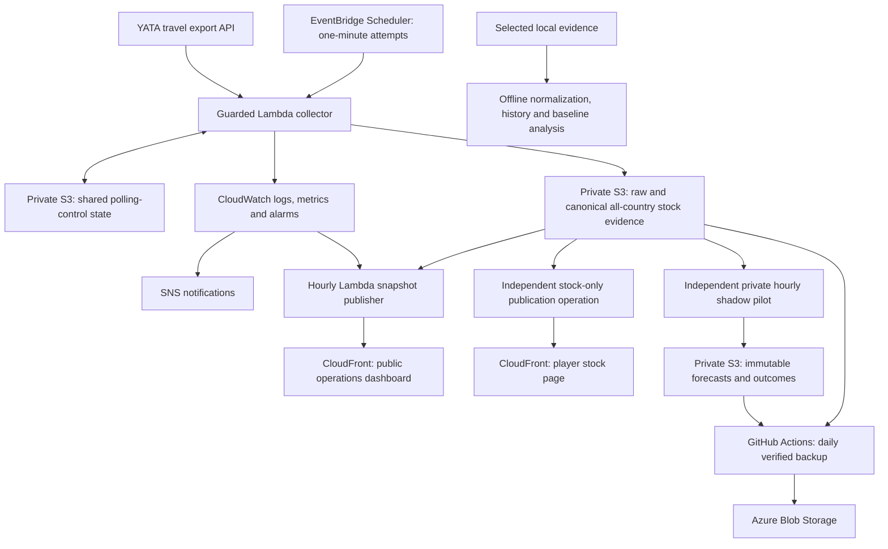

# TornRedeye

TornRedeye explores foreign-market stock observations in Torn, an online game.
It preserves overseas shop evidence to study availability, restock intervals and
sellout patterns, with probabilistic forecasting as an experimental capability.
YATA (yata.yt) is the external, third-party API source used to retrieve Torn
overseas shop stock data through its travel export endpoint. YATA supplies
observations; TornRedeye independently collects, preserves and analyzes that
evidence and develops experimental forecasts. Missing or stale reports never
imply observed zero stock.

## How it works

TornRedeye collects stock observations into private evidence storage, with
independent monitoring, backup, reporting and experimental forecasting components.
The diagram shows implemented software components and their data flows; it does
not indicate which production schedules are currently enabled. Deployment and
operation are described in the [deployment guide](docs/deployment.md). Public
delivery remains disabled pending the [activation gates](docs/deployment.md#cloudfront-free-activation-boundary).



Shared Python normalization processes every returned country and item. The
independent shadow consumer reads retained evidence without making YATA requests; its experimental
60-minute forecasts remain private and are not available to players. The public
dashboard reports operations, not forecasts. Backup scope includes raw/canonical
stock evidence and immutable forecast, acknowledgement, outcome and checkpoint
records; mutable forecast state and polling control are excluded. Local historical
analysis is a separate offline capability.

The polling guard prevents overlapping requests, enforces minimum spacing and
honors `Retry-After` cooldowns; restrictions or uncertain attempts stop collection
for operator review. Evidence retains original bytes, timestamps and provenance,
with canonical records linking available raw bytes by key and SHA-256 hash.
Conditional writes prevent overwrites; conflicts and partial failures remain
visible. Monitoring distinguishes persisted acquisitions from HTTP success, and
backups verify uploaded archives and payload hashes by reading them back.

## Technology stack

| Technology | Responsibility |
| --- | --- |
| YATA travel export API | Supply third-party observations of Torn overseas shop stock. |
| Python | Collect and normalize observations, preserve evidence, run offline analysis and private shadow forecasting, and verify backups. |
| AWS EventBridge Scheduler and Lambda | Schedule guarded collection and run serverless collector, publisher and independent forecast functions. |
| Amazon S3 | Keep private raw/canonical stock evidence, polling-control state and forecast records/state; separately store dashboard assets and snapshots. |
| CloudWatch and SNS | Monitor collection through logs, metrics and alarms, and route notifications to configured, confirmed subscriptions. |
| GitHub Actions | Run verified daily backups with short-lived AWS/Azure access through OpenID Connect (OIDC). |
| Azure Blob Storage | Keep independent evidence and immutable forecast backups, including archives and integrity records. |
| Amazon CloudFront and CloudFront Functions | Deliver static operations and player stock pages over HTTPS from a private S3 origin; apply managed policies and the viewer-response security Function in FREE mode. |
| AWS WAF | Associate the dedicated ACL with CloudFront; the initial COUNT rate rule observes traffic without blocking it. |
| React, TypeScript and Vite | Build the player stock interface as static assets; operations pages retain their existing frontend. |
| AWS SAM / CloudFormation | Define cloud resources and permissions as reviewable templates; deployment and schedule activation remain separate actions. |

## Capabilities and limitations

- **Implemented operational foundation:** guarded collection, immutable evidence
  writes, integrity-checked incremental backups and an operations dashboard.
- **Player stock presentation:** a lightweight all-country stock snapshot and
  automatically refreshing React interface with item/country browsing, reported
  quantities, shop prices,
  descriptive changes and separate source/collection/publication times. Production
  event wiring and publication remain separately gated; see the
  [stock reporting contract](docs/dashboard.md#player-stock-page-issue-75).
- **Implemented shared processing:** deterministic all-country/item normalization,
  field diagnostics and reusable local history analysis. Time-partitioned evidence
  supports bounded prospective reads and independently verified Azure recovery.
  Historical evidence retains its original bytes and provenance separately from
  the operational lineage; operational readers do not rewrite it or use historical
  labels to train current forecasts.
- **Experimental forecasting:** offline empirical/persistence comparison for a
  selected country/item and private requested-time accounting. The separate
  hourly shadow pilot retains its Hawaii Shark Fin selection and 60-minute
  horizon; its AWS definition defaults to disabled. Predictions are not validated
  purchasing or travel advice.
- **Planned product capabilities:** broader stock intelligence, historical trends,
  adaptive forecasting across country/item pairs and availability at requested
  times (including travel arrival) are described in the [roadmap](docs/roadmap.md).
  The hourly, 60-minute pilot is a bounded experiment, not a universal horizon or
  update frequency. Broader forecasting and travel support remain planned.
  They are not implementation commitments.

## Getting started

Use Python 3.11 or newer, from the repository root:

```sh
python -B -m unittest discover -s tests
python -B -m tornredeye.stock_history --help
python -B -m tornredeye.availability_forecast --help
```

Tests use synthetic evidence and fake cloud clients; no cloud credentials are
needed. Local analysis requires an explicitly selected private evidence subset.
Deployment and any live source/storage access are separate operating actions.

The player frontend uses Node 24 or newer. Install its locked dependencies with
`npm --prefix frontend ci`, then run `npm --prefix frontend test` and
`npm --prefix frontend run build`. Assemble the stock page beside the unchanged
operations assets with `python -m tools.package_stock_frontend`. In Windows
PowerShell, use `npm.cmd` in place of `npm`. See the
[local player preview](docs/dashboard.md#build-and-local-player-preview) for honest
archived/synthetic preview inputs and the static hosting boundary.

## Repository layout

```text
tornredeye/    Shared normalization, stock history and experimental accounting
tools/         Lambda/static package builders and local preview/backup helpers
tests/         Deterministic tests and fixtures
docs/          Contracts, operation instructions and product roadmap
dashboard/     Existing static operations dashboard and preserved stock regression
frontend/      React, TypeScript and Vite player stock interface
```

Operational Lambda entry points, their supporting collector/backup modules and
AWS templates remain at the root to preserve deployed handlers and operating
commands. Lambda package builders include the shared Python package where required
and need no additional framework. Frontend dependencies and builds are scoped to
`frontend/`.

## Documentation

- [Shared stock normalization and integration boundary](docs/stock-normalization.md)
- [Local stock history](docs/stock-history.md)
- [Offline availability baseline](docs/availability-forecast.md)
- [Private shadow forecasting](docs/shadow-forecast.md)
- [Deployment and operation](docs/deployment.md)
- [Dated AWS cost assessment and hosting constraints](docs/aws-cost-protection.md)
- [Monitoring and resource use](docs/monitoring.md)
- [Backup, verification and recovery](docs/evidence-backup.md)
- [Public operations dashboard](docs/dashboard.md)
- [Long-term product roadmap](docs/roadmap.md)
