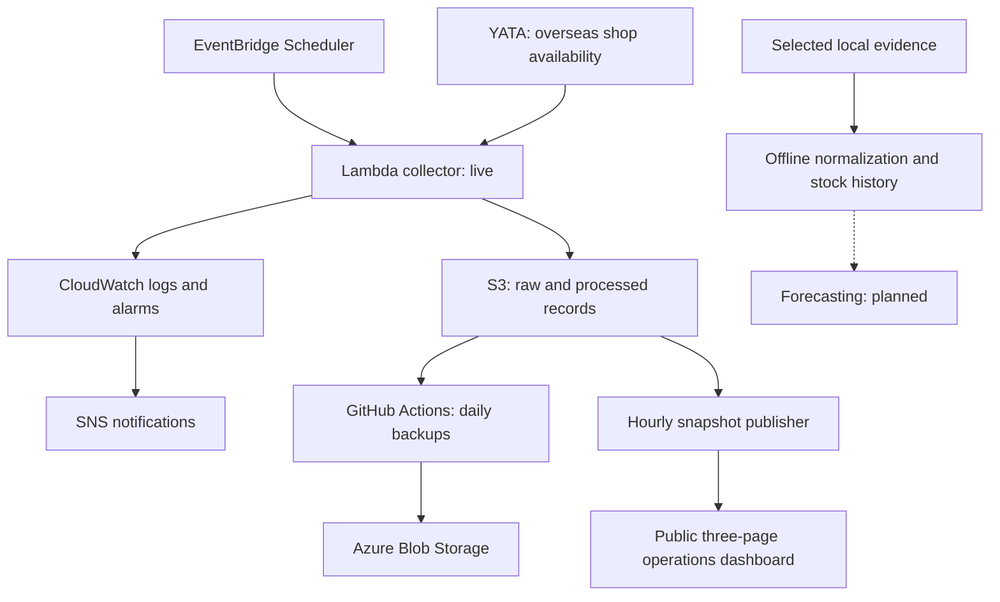

# TornRedeye

Torn is an online browser-based game with overseas shops where players buy items.
TornRedeye tracks foreign stock availability in those shops to learn when they
restock and how quickly their stock sells out. The operational AWS collector
normalizes one stock listing in Japan and retains complete YATA travel exports
for offline analysis across countries and items.

The long-term goal is adaptive probabilistic forecasts for all supported
country/item combinations, using shared methods and updating as new observations
arrive, including predictions multiple replenishment cycles ahead. Hawaii Shark
Fin is the initial research and validation case for this broader scope.
Statistical forecasting would come first, accounting for stock depletion,
replenishment patterns, time-dependent demand, source freshness, gaps and
uncertainty. Machine learning remains a potential later improvement, evaluated
against historical backtesting results. These forecasting capabilities and
automatic forecast updates are planned, not implemented.

## How it works

The collector saves original responses and processed records in S3, building a
history of foreign stock availability. Monitoring follows collection health,
while scheduled backups keep an independently verified copy in Azure. A public
three-page dashboard reports operations, diagnostics and infrastructure usage.
Local tools normalize complete exports and analyze observed stock history.



Solid arrows show implemented paths; the dotted branch is planned forecasting.

## Technology stack

| Technology | Responsibility |
| --- | --- |
| Python | Collect and validate API responses, store records, and verify backups. |
| AWS EventBridge Scheduler and Lambda | Trigger and run the collector without maintaining a server. |
| Amazon S3 | Hold the primary evidence history and shared polling-control state. |
| CloudWatch and SNS | Turn logs and metrics into alarms and route configured notifications. |
| GitHub Actions | Run the backup workflow with short-lived cloud access through OIDC authentication. |
| Azure Blob Storage | Keep the independent backup, including archives and integrity manifests. |

AWS SAM/CloudFormation templates define the collector, storage and monitoring
resources, so their configuration is reviewed alongside the code.

## Engineering highlights

- **Scheduled collection with safeguards.** A one-minute schedule starts
  collection attempts. A shared polling guard prevents overlapping requests,
  enforces minimum spacing and honors `Retry-After` cooldowns. Access restrictions
  or abandoned attempts stop collection for operator review.

- **Evidence that remains traceable.** Original response bytes and normalized
  JSON records use separate S3 prefixes. UTC retrieval times, available source
  timestamps and provenance details preserve where each result came from.
  Processed records link to available raw evidence through its key and SHA-256
  hash. Missing information is recorded rather than treated as no stock available.

- **Safe retries and visible failures.** Conditional S3 writes make retrying the
  same collection idempotent: matching data is accepted and missing writes can
  finish without overwriting existing records. Conflicts and partial failures
  are reported. Each new retrieval gets its own identity, even when YATA returns
  cached data; repeated observations are not silently discarded.

- **Monitoring tied to saved observations.** CloudWatch alarms detect gaps in
  successfully persisted observations, repeated Lambda errors and polling halts.
  An HTTP success alone does not count as a saved observation. SNS provides the
  notification route; delivery depends on the configured, confirmed subscription.

- **Incremental backups with integrity checks.** The AWS-to-Azure runner
  transfers new or detectably changed evidence. It reads uploaded archives back
  and verifies SHA-256 hashes, payloads and metadata before recording completion.
  Recovery checks cover the historical baseline plus increments, retaining
  original bytes and provenance. Manual backup and recovery verification have
  completed.

- **Practical resource limits.** Compact coverage manifests avoid repeatedly
  downloading historical payloads. Limits on requests, running time and temporary storage help prevent backup jobs from using excessive resources. The collector uses 128 MiB of Lambda memory
  and 14-day log retention; monitoring avoids paid detailed S3 request metrics.
  Actual costs still depend on stored data and cloud usage.

## Current progress

The AWS collection system is operational. The independent Azure backup's
[first unattended scheduled run was verified on October 14, 2026](https://github.com/epmelito/TornRedeye/issues/23#issuecomment-6173917639),
with subsequent successful scheduled runs through
[October 18, 2026](https://github.com/epmelito/TornRedeye/actions/runs/39110394657).

The public dashboard is deployed with Operations, Diagnostics, and
Infrastructure & Usage pages. Hourly scheduled publication was
[verified on October 15, 2026](https://github.com/epmelito/TornRedeye/issues/10#issuecomment-6198958432).

Offline all-stock normalization and
[reusable local stock-history analysis](https://github.com/epmelito/TornRedeye/pull/35)
are implemented. These are local analysis tools; forecasting and restock
predictions remain unimplemented.

## Running locally

Use Python 3.11 or newer. From the repository root, run the offline Python tests:

```sh
python -B -m unittest discover -s tests
```

No cloud credentials are needed; the suite uses synthetic data and fake cloud
clients. See the links below for deployment and operating instructions.

The separate [offline all-stock normalizer](docs/stock-normalization.md) can
process every returned country and item from retained YATA export bytes. It
preserves raw evidence identity and timestamps and reports partial validation
without changing the live Japan collector or writing new evidence.

## Further information

- [Deployment and operation](docs/deployment.md)
- [Monitoring, alerts and resource use](docs/monitoring.md)
- [Backups, verification and recovery](docs/evidence-backup.md)
- [Public operations dashboard](docs/dashboard.md)
- [Offline all-stock normalization](docs/stock-normalization.md)
- [Local stock history (Hawaii Shark Fin example)](docs/stock-history.md)
